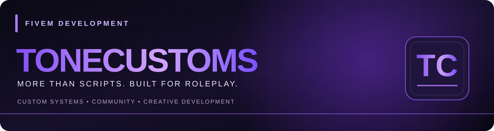

<div align="center">



# TONECUSTOMS

### Custom FiveM Development • Gameplay Systems • Server Tools

**Hey, I'm Tone — founder and developer of ToneCustoms.**

I develop FiveM resources focused on **immersive gameplay, practical server systems, and giving players more meaningful activities.**

*Built for Roleplay. Made with Purpose.*

[](https://tonyiswavy.github.io/tonecustoms-docs/)
[](https://discord.gg/JdZ7NTG5KF)
[](https://www.youtube.com/@tonyiswavy12)
[](https://tonecustoms.tebex.store/)

</div>

---

## Explore ToneCustoms

| Explore | Destination |
| :--- | :--- |
| **Script demonstrations** | [See gameplay showcases](#featured-script-demonstrations) |
| **Product guides** | [Browse product documentation](https://tonyiswavy.github.io/tonecustoms-docs/products/) |
| **Free resources** | [Free FiveM Resources directory](#free-fivem-resources) |
| **Public repositories** | [Repository directory and project status](#featured-public-repositories) |
| **Development progress** | [ToneCustoms Development Board](https://github.com/users/tonyiswavy/projects/7) |
| **Customer support** | [Support and policies](https://tonyiswavy.github.io/tonecustoms-docs/SUPPORT) |

## About ToneCustoms

**Built from real FiveM server experience.** My approach to development starts with gameplay: how the resource feels to players, how staff manage it, and how the system fits into an active roleplay city.

- **Gameplay variety:** Jobs, interactions, progression, and immersive mechanics.
- **Practical server systems:** Tools that are useful to server owners and staff.
- **Iterative development:** Build, improve, and validate functionality before calling something a finished release.
- **Original identity:** ToneCustoms branding across custom development projects.

> **Development principle:** Working functionality comes before version numbers. Active work is not automatically a released product.

## GitHub Activity

GitHub tracks contributions automatically. **[View the official GitHub contribution graph](https://github.com/tonyiswavy?tab=overview)** for GitHub's own activity record. The stats and language cards below refresh periodically through a third-party provider; they are **not real-time** and may omit private repository data.

<div align="center">

<a href="https://github.com/tonyiswavy">

</a>
<p><strong>Repository Languages</strong></p>


<sub>This third-party chart summarizes languages detected in accessible GitHub repositories. It does not represent every private ToneCustoms script or the full development stack.</sub>

<p><strong>Technology Stack</strong></p>

<p>


</p>

<sub>Statistics and language percentages are generated by an external service, can be cached or incomplete, and do not guarantee inclusion of private work. The grade remains enabled when the stats provider is available; the technology badges show tools used for ToneCustoms development, not a measured language ranking.</sub>

**[View GitHub contributions](https://github.com/tonyiswavy?tab=overview)** · **[Browse public repositories](https://github.com/tonyiswavy?tab=repositories)**

</div>

## Development Stack

<div align="center">


</div>

| Frameworks | FiveM integrations | Focus |
| :--- | :--- | :--- |
| **Qbox · QBCore · ESX** | **ox_lib · ox_inventory · ox_target · oxmysql** | **Lua resources · UI/UX · gameplay systems · administration tools** |

<sub>Individual script support and requirements depend on the resource.</sub>

## Featured Script Demonstrations

Here are examples of my FiveM development work and video walkthroughs. Video links are showcases, **not claims that source code is public or that a product is released**.

| Project | Focus | Watch |
| :--- | :--- | :---: |
| **ToneCustoms Gun Jam** | Weapon-jamming gameplay mechanic | [Watch demo](https://youtu.be/kPniOo-VThw) |
| **ToneCustoms Queue** | Whitelist and queue management | [Watch demo](https://youtu.be/qhEbaAJHqpQ) |
| **Farming System** | Farming gameplay | [Watch demo](https://youtu.be/MWF8Kgai5KA) |
| **Skills System** | Skill progression | [Watch demo](https://youtu.be/TYk_jkLa8wM) |
| **3D Roleplay Text** | /me and /do interaction | [Watch demo](https://youtu.be/i4d7FPA4Ces) |
| **Multi Job** | Multiple job management | [Watch demo](https://youtu.be/WhsA_jp7LC4) |

<div align="center">

**[Explore more ToneCustoms videos →](https://www.youtube.com/@tonyiswavy12)**

</div>

## Explore Each Script

The documentation pages below explain each project's purpose and distinguish store-listed resources from development showcases.

| Resource | Documentation | Presentation |
| :--- | :--- | :--- |
| **Gun Jam** | [Product guide](https://tonyiswavy.github.io/tonecustoms-docs/products/gun-jam) | Store-listed at last review; [watch demo](https://youtu.be/kPniOo-VThw) |
| **Family System** | [Product guide](https://tonyiswavy.github.io/tonecustoms-docs/products/family-system) | Store-listed at last review |
| **Window Cleaning** | [Product guide](https://tonyiswavy.github.io/tonecustoms-docs/products/window-cleaning) | Store-listed at last review |
| **Queue** | [Project overview](https://tonyiswavy.github.io/tonecustoms-docs/products/queue) | Development showcase |
| **Farming** | [Project overview](https://tonyiswavy.github.io/tonecustoms-docs/products/farming) | Development showcase |
| **Skills** | [Project overview](https://tonyiswavy.github.io/tonecustoms-docs/products/skills) | Development showcase |
| **3D Roleplay Text** | [Project overview](https://tonyiswavy.github.io/tonecustoms-docs/products/roleplay-text) | Development showcase |
| **Multi Job** | [Project overview](https://tonyiswavy.github.io/tonecustoms-docs/products/multi-job) | Development showcase |
| **Pharmacy** | [Development overview](https://tonyiswavy.github.io/tonecustoms-docs/products/pharmacy) | In development |

*Check the [official storefront](https://tonecustoms.tebex.store/) for current product availability. A showcase does not establish a public release.*

## Quick Start

Whether you're exploring ToneCustoms resources or setting up a purchase, start here:

| Looking for | Official destination |
| :--- | :--- |
| **Browse resources** | [Interactive product catalog](https://tonyiswavy.github.io/tonecustoms-docs/products/) |
| **Install a resource** | [Installation guides](https://tonyiswavy.github.io/tonecustoms-docs/INSTALLATION) |
| **Confirm compatibility** | [Framework and dependency information](https://tonyiswavy.github.io/tonecustoms-docs/COMPATIBILITY) |
| **Get technical help** | [Support guide](https://tonyiswavy.github.io/tonecustoms-docs/SUPPORT) |
| **Read customer policies** | [Customer policy center](https://tonyiswavy.github.io/tonecustoms-docs/policies/) |

### Featured Product Guides

- **[Gun Jam](https://tonyiswavy.github.io/tonecustoms-docs/products/gun-jam)** — features, installation, troubleshooting and release information.
- **[Family System](https://tonyiswavy.github.io/tonecustoms-docs/products/family-system)** — product overview and customer guidance.
- **[Window Cleaning](https://tonyiswavy.github.io/tonecustoms-docs/products/window-cleaning)** — job mechanics, setup and troubleshooting.

*For current prices, availability and purchase terms, refer to the [official ToneCustoms store](https://tonecustoms.tebex.store/). Documentation and demonstration videos do not by themselves establish release availability.*

## Development & Release Philosophy

```text
Idea → Development → In-game testing → Refinement → Verified working build → Release
```

I keep source projects and custom asset libraries private unless I explicitly choose to publish them. Public documentation, discussions, and video showcases are separate from private development.

**[ToneCustoms Development Board](https://github.com/users/tonyiswavy/projects/7)** · **[Development Documentation](https://tonyiswavy.github.io/tonecustoms-docs/development/README)**

The development board tracks project workflow; access to individual project items may depend on repository permissions. A tracked project does not automatically mean its source is public or its product has been released.

## Free FiveM Resources

Explore the [ToneCustoms Free Scripts directory](https://tonyiswavy.github.io/tonecustoms-docs/products/free-resources) for officially approved public downloads when available. This directory does not contain paid source code, and no free release is announced solely by creating a documentation page.

## Featured Public Repositories

### Start with the documentation

**[ToneCustoms Documentation](https://github.com/tonyiswavy/tonecustoms-docs)** is the main public resource for installation, troubleshooting, product information and customer support.

**[Open the documentation website](https://tonyiswavy.github.io/tonecustoms-docs/)** · **[Browse product guides](https://tonyiswavy.github.io/tonecustoms-docs/products/)** · **[Get support](https://tonyiswavy.github.io/tonecustoms-docs/SUPPORT)**

### Public repository directory

Browse ToneCustoms' official documentation and public project information. Protected commercial source code stays private.

| Repository | Purpose | Public status |
| :--- | :--- | :--- |
| **[ToneCustoms Documentation](https://github.com/tonyiswavy/tonecustoms-docs)** | Product guides, installation, troubleshooting, customer support and policies. | **Documentation live** |
| **[ToneCustoms Shell Studio](https://github.com/tonyiswavy/ToneCustoms-Shell-Studio)** | Planned Windows tool for designing and preparing FiveM interior shells. | **Planning / development showcase** |
| **[Prop Generator Updates](https://github.com/tonyiswavy/tonecustoms-prop-generator-updates)** | Machine-readable update manifest for the private ToneCustoms Prop Generator. | **Update metadata only** |

**For released script availability, check [ToneCustoms Tebex](https://tonecustoms.tebex.store/).** A repository, development overview, or demonstration is not necessarily a downloadable release.

**[Explore official docs](https://tonyiswavy.github.io/tonecustoms-docs/)** · **[Browse public GitHub repositories](https://github.com/tonyiswavy?tab=repositories)** · **[Join Discord](https://discord.gg/JdZ7NTG5KF)** · **[Subscribe on YouTube](https://www.youtube.com/@tonyiswavy12)**

## Customer Information

For product availability, installation expectations, licensing questions, support, and release status, use the official resources below. The official store and checkout determine applicable purchase terms; public documentation provides product and support information.

**[Browse Product Documentation](https://tonyiswavy.github.io/tonecustoms-docs/products/)** · **[Customer Information & Policies](https://tonyiswavy.github.io/tonecustoms-docs/policies/)**

## Official Links

| Destination | Link |
| :--- | :--- |
| **Documentation** | [ToneCustoms Documentation Website](https://tonyiswavy.github.io/tonecustoms-docs/) |
| **Product catalog** | [Browse documented resources](https://tonyiswavy.github.io/tonecustoms-docs/products/) |
| **Customer information** | [Policies and support](https://tonyiswavy.github.io/tonecustoms-docs/policies/) |
| **Announcements & community discussion** | [GitHub Discussions](https://github.com/tonyiswavy/tonecustoms-docs/discussions) |
| **Community / Support** | [Discord](https://discord.gg/JdZ7NTG5KF) |
| **Gameplay showcases** | [YouTube](https://www.youtube.com/@tonyiswavy12) |
| **Store** | [ToneCustoms Tebex](https://tonecustoms.tebex.store/) |

<div align="center">

---

### TONECUSTOMS

**Built for roleplay. Made with purpose.**

</div>
